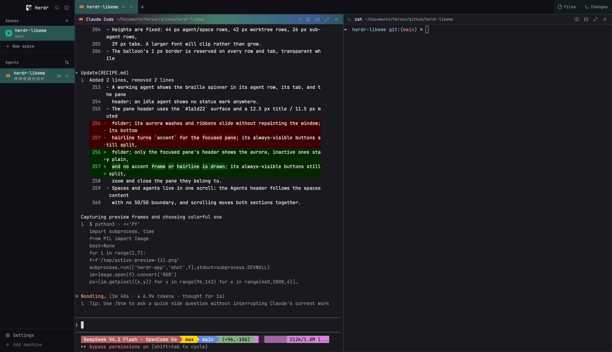

# Likeme

A Herdr layout built on top of the shipped `main` layout: every space and agent row
is an icon with two lines of text beside it, the active item is a flat, square tint in
with its space's colour (the active tab too), and the working spinner is a gold braille
character instead of a rotating ring.

Built from Herdr `main` @ 0.1.12 (`cloned_from` in `layouts/likeme.json`).



_A live capture: the two-line rows, the flat square selection, the tab close buttons
and the braille spinner are the real UI._

## What changes

| Area | Change |
|---|---|
| **Sidebar** | Spaces and agents share one scrolling column; the Agents section follows the spaces content instead of starting at the sidebar's midpoint, and the whole column scrolls together. |
| **Spaces** | A 20 px tinted monogram with a dark letter; the project name (13 px) over the current git branch (11 px, muted, plus ahead/behind). Rows are square, full-bleed and flush against each other with no gap; resting rows lie flat under a whisper of the space's colour, while the active space is a flat opaque tint with no border or shadow; worktrees hang from a 1 px tree line under their checkout; with fewer than three spaces a dashed "New space" row fills the gap. |
| **Agents** | The same square, full-bleed two-line row (space name over the agent's own title) with a whisper of its space's colour and no gap between rows; the focused agent is the same flat opaque tint, again without a border, instead of an accent bar. The column watches its data on a 250 ms timer and redraws when it changes, so focus and status turns show without hovering; an idle agent shows no status mark. The elapsed time and pin share a fixed slot, so hovering never shifts the text. A single group hides its redundant header, and the sort button uses an up/down icon. |
| **Tabs** | Tabs are square, fill the bar's full height and sit flush against each other with no gap; the active tab is the same flat opaque tint as a selected sidebar row, tinted with the space's colour and drawn without a border or shadow, while the others lie flat and keep a close button (dimmer when inactive). The `Files`/`Changes` toggles at the right are the same square, full-height blocks, tinted like the active tab when their panel is open. A default-numbered tab shows what it runs — the folder name, or the program when two tabs share it — and `+` sits right after the last tab. A zoomed tab gets a small zoom glyph instead of a trailing `Z`. The working spinner is a gold braille character (`⠋⠙⠹⠸⠼⠴⠦⠧⠇⠏`, 80 ms per frame). |
| **Panes** | Square corners and no gap, padding or terminal padding — the pane fills the work area edge to edge — a slightly lifted card surface (`#1a1d22`), and a cloned header on that same surface. Only the active pane's header paints a left-to-right aurora behind its text: a static wash that fades in from the dark left edge, plus four translucent colour ribbons sliding across at different speeds (native animations, no timer); inactive headers stay plain. The aurora is the focus mark — there is no accent frame or hairline, so no bright square corner is drawn into the window's rounded bottom-right. The split/zoom/close buttons are always visible; the status mark appears for working, blocked and done (nothing while idle). The header's working spinner is the same gold braille character as the tabs and agents. |
| **Files / Changes** | Cloned from Herdr's `files` and `changes` mods with square corners: the panel body, the file and changed-file rows, the changed-file count badge and the commit field and button lose their rounding. |

Everything else — brand bar, menus — is Herdr's `main` layout unchanged.

## Requirements

- Herdr 0.1.12 or newer.
- Herdr's shipped mods and assets that this layout references:
  `workspace-chrome`, `pane` (the tab bar borrows its close/zoom icons),
  `menu`, `new-menu`, and the usual dialog/overlay mods.

## Install

One command, straight from `main` (it always downloads the latest, so it is also the
update command):

```sh
curl -fsSL https://raw.githubusercontent.com/BeIllusyn/herdr-likeme/main/install.sh | bash
```

Or from a checkout (`git pull` first to update):

```sh
git clone https://github.com/BeIllusyn/herdr-likeme.git
cd herdr-likeme
./install.sh
```

`install.sh` copies `layouts/likeme.json` and the five mods into
`${HERDR_APP_HOME:-~/.config/herdr-app}`, runs `herdr-app check` on every mod, and
switches to the layout. Herdr reloads the files within a second.

It **overwrites** `layouts/likeme.json` and the `mods/my-*` folders on every run
(`rsync --delete`), so edits made directly in `~/.config/herdr-app` are replaced —
copy them back to the repo first. It never touches your other layouts, mods, spaces
or terminals. The one-line form always fetches the current `REF` (default `main`);
the checkout form uses the files in that checkout.

Manual install:

```sh
DST=~/.config/herdr-app

cp layouts/likeme.json "$DST/layouts/"
cp -R mods/my-sidebar mods/my-tabs mods/my-pane mods/my-files mods/my-changes "$DST/mods/"

herdr-app check "$DST/mods/my-sidebar"
herdr-app check "$DST/mods/my-tabs"
herdr-app check "$DST/mods/my-pane"
herdr-app check "$DST/mods/my-files"
herdr-app check "$DST/mods/my-changes"
herdr-app do layout.switch '{"name":"likeme"}'
```

Never overwrite a layout or mod you already have: rename the new one and update the
matching `"mod"` references in `likeme.json`.

- Update: run the one-liner again, or `git pull && ./install.sh`
- Uninstall: delete `layouts/likeme.json`, `layouts/likeme.png` (if present) and the
  `mods/my-sidebar`, `mods/my-tabs`, `mods/my-pane`, `mods/my-files`, `mods/my-changes`
  folders. If you
  upgraded from a version before the merged sidebar, also delete the old
  `mods/my-spaces` and `mods/my-agents` folders; their code now lives inside
  `mods/my-sidebar`.

## What the mods do

Herdr mods are trusted code: they can run programs, use the network and read files.
These five are meant to be read:

- **`my-sidebar`** is one mod with two retained child views (`spaces.js` and
  `agents.js`) in one scroll column. The spaces half runs
  `git --no-optional-locks status --porcelain=v2 --branch` and `git rev-parse` in each
  space's live folder via `exec`, calls `hc machine ls` every 15 s, and watches local
  git repos with `watchFolder`. The agents half uses Herdr's live agent/terminal data.
  Both use shipped SVGs; it reads git metadata and the local machine list and sends
  nothing over the network.
- **`my-tabs`** uses Herdr's live tab/pane data and shipped SVGs. No `exec`, no
  network.
- **`my-pane`** is a clone of the shipped pane header; it reads the same live pane
  data, paints the focused pane's aurora, and carries its own split/zoom/close SVGs.
  No `exec`, no network.
- **`my-files`** is a lazy file browser for the focused pane's folder. It lists
  directories with `sh` (or PowerShell on Windows), previews files with
  `readTextFile`, and watches folders with `watchFolder`. No network.
- **`my-changes`** is a clone of the shipped changes panel. It runs read-only git
  commands (`status`, `diff`, `rev-parse`) via `exec` and watches the worktree. No
  network.

`RECIPE.md` has the full build notes, including the exact layout tree, the two-line
row structure, and what a fresh build would get wrong.

## License

MIT. See [LICENSE](LICENSE).
