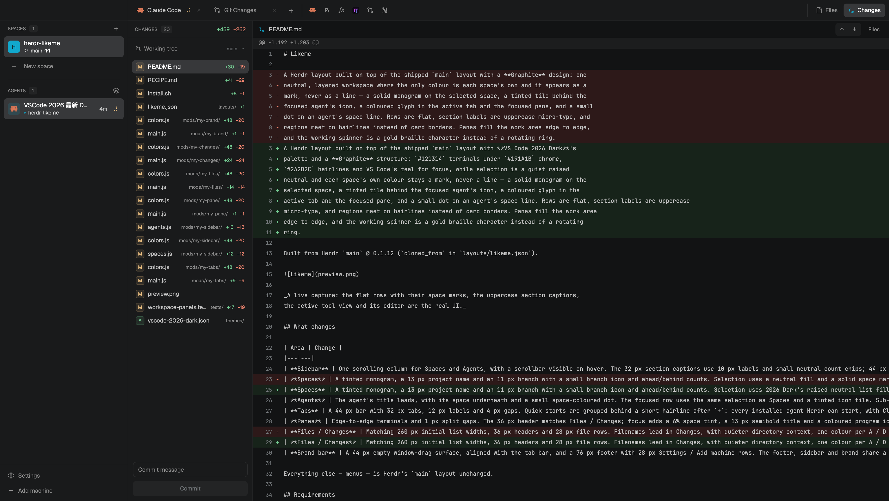

# Likeme

A Herdr layout built on top of the shipped `main` layout with **VS Code 2026 Dark**'s
palette (and a matching **2026 Light** theme) plus a **Graphite** structure: `#121314`
terminals under `#191A1B` chrome,
`#2A2B2C` hairlines and VS Code's teal for focus, while selection is a quiet raised
neutral and each space's own colour stays a mark, never a line — a solid monogram on the
selected space, a tinted tile behind the focused agent's icon, a coloured glyph in the
active tab and the focused pane, and a small dot on an agent's space line. Rows are flat, section labels are uppercase
micro-type, and regions meet on hairlines instead of card borders. Panes fill the work area
edge to edge, and the working spinner is a gold braille character instead of a rotating
ring.

Built from Herdr `main` @ 0.1.12 (`cloned_from` in `layouts/likeme.json`).



_A live capture: the flat rows with their space marks, the uppercase section captions,
the active tool view and its editor are the real UI._

## What changes

| Area | Change |
|---|---|
| **Sidebar** | One scrolling column for Spaces and Agents, with a scrollbar visible on hover. The 32 px section captions use 10 px labels and small neutral count chips; 44 px rows, 26 px marks and 3 px gaps give both lists the same rhythm. Both retained views check live data every 250 ms (1 s in the background) and redraw only when it changes. |
| **Spaces** | A tinted monogram and a 13 px project name followed inline by the 11 px working directory name, with a full-path tooltip. The branch and ahead/behind counts reflect that directory. Selection uses the theme's raised neutral list fill while its text and icons take a contrasting ink, and the space mark stays solid; its ink automatically chooses dark or white for contrast. Worktrees sit under their checkout with a branch glyph that shares the checkout title's column, their own names stepping one glyph further in. A 32 px New space action ends the list. |
| **Agents** | The agent's title leads, with its space underneath and a small space-coloured dot. The focused row uses the same selection as Spaces and a tinted icon tile. Sub-agent rows are 26 px. Working, Needs you, Done and Idle remain visible; elapsed time and pin share a fixed slot. Priority keeps its section headers; Grouped hides a redundant single-space header. |
| **Tabs** | A 44 px bar with 32 px tabs, 12 px labels and 4 px gaps. The active tab takes the theme's raised neutral fill with contrasting ink, a semibold name and its program icon in the space's colour. Quick starts are grouped behind a short hairline after `+`: every installed agent Herdr can start, with Claude Code (`--dangerously-skip-permissions`) and Pi leading, plus Lazygit and Neovim. Quick starts open in the selected space's working directory, regardless of the current tab or a terminal's `cd`. Files / Changes reuse the matching tool tab in the selected space or create one rooted at that same folder. Tabs keep drag, rename, zoom and close actions; close buttons brighten on hover. |
| **Panes** | Edge-to-edge terminals and 1 px split gaps. The 36 px header matches Files / Changes; focus adds a 6% space tint, a 13 px semibold title and a coloured program icon. Folder text is 11 px, the fixed status slot is 68 px, and split / zoom / close controls are grouped 24 px buttons with tooltips. Close actions use a red hover state. |
| **Files / Changes** | Matching 260 px initial list widths, 36 px headers and 28 px file rows. Files draws Material Icon Theme's own artwork for a file's type, so a language, config file, image or archive each read at a glance; the theme's full-colour SVGs keep their palette instead of taking the theme ink, and a name the tables do not know keeps the plain page. Filenames lead in Changes, with quieter directory context, one colour per A / D / U / M status across both views, tinted and edged status tiles, and full-path tooltips. File previews keep the editor and optimistic auto-save, with a fixed-width save indicator and a larger Edit / Diff switch. Full-file diffs and before/after comparisons use 12 px type, 22 px rows, VS Code's green and red diff inks over a 15% wash, syntax colours from 2026 Dark or Light, and coloured `+` / `−` signs. The before/after divider drags to set each half's width, and each half scrolls horizontally on its own with line numbers and signs pinned, so a long line is read in full instead of being ellipsized. Change navigation is grouped in the header. Lists remain virtualized, and switching views preserves folders and split widths. Both views share the same empty-state styling; a clean worktree shows All caught up. A source row above the changed files switches between the working tree and another local or remote branch: the chosen branch is compared from its merge base to HEAD (committed changes only), drives the same list and whole-file diff, and replaces the commit box with a quiet note. |
| **Floating files** | A button at the right of the Files preview header opens the current file in a borderless panel floating over the layout. The panel keeps its own tab row, so files opened from different spaces sit side by side; each tab remembers its own root and machine. Local files edit and auto-save exactly as they do in Files, files on another machine stay read-only, and the panel follows the theme. Its tab row's right-hand collapse button hides the panel and leaves a 40 px square button anchored to the window's bottom-right; pressing that brings the panel back. |
| **Brand bar** | A 44 px empty window-drag surface, aligned with the tab bar, and a 76 px footer with 28 px Settings / Add machine rows. The footer, sidebar and brand share a continuous, faint right-hand divider. |

Everything else — menus — is Herdr's `main` layout unchanged.

## Requirements

- Herdr 0.1.12 or newer.
- `omp` and `fx` themselves are optional: likeme always adds Herdr's program
  entries for them, so each CLI is recognized whenever it is installed later.
  `LIKEME_OMP=0` and `LIKEME_FX=0` opt out.
  - likeme only adds Herdr's recognition entries; it never installs either CLI.
    Install omp with the upstream method, e.g. `curl -fsSL https://omp.sh/install | sh`,
    `brew install can1357/tap/omp`, or `bun install -g @oh-my-pi/pi-coding-agent`
    (its installer verifies the downloaded binary's SHA-256). Install fx with
    `curl -fsSL https://fx.sh/setup.sh | bash` (it lands in `~/.local/bin`).
    likeme never runs either installer.
- Herdr's shipped mods and assets that this layout references:
  `workspace-chrome`, `pane` (the tab bar borrows its close/zoom icons),
  `menu`, `new-menu`, the program icons under `icons/` (the quick starts),
  and the usual dialog/overlay mods.
- Nothing else is downloaded: the file-type icons in `mods/my-files/material/`
  ship with this repo (Material Icon Theme 5.40.0, MIT; its license sits beside
  them).

## Install

One command, straight from `main` (it always downloads the latest, so it is also the
update command):

```sh
curl -fsSL https://raw.githubusercontent.com/BeIllusyn/herdr-likeme/main/install.sh | bash
```

Or from a checkout (`git pull` first to update):

```sh
git clone https://github.com/BeIllusyn/herdr-likeme.git
cd herdr-likeme
./install.sh
```

`install.sh` copies `layouts/likeme.json`, the seven mods and all four themes into
`${HERDR_APP_HOME:-~/.config/herdr-app}`, runs `herdr-app check` on every mod, adds
Herdr's omp and fx program entries, and switches to the layout. Herdr reloads the files
within a second.

The layout defaults to `{"light": "vscode-2026-light", "dark": "vscode-2026-dark"}`.
Herdr's appearance chooses one: set Light or Dark in Settings, or set `appearance` in
`settings.json` (remove it to follow the system). A theme picked in Settings still wins
over the layout; `install.sh` never forces one. These are ordinary
Herdr theme files: each names the terminal background, foreground, selection, cursor and
16 ANSI colours, and overrides the panel palette (`surface`, `chrome`, `hover`,
`selected`, `border`, `input`, `accent`, the agent states). 2026 Dark keeps `#121314`
terminals under `#191A1B` chrome with `#BFBFBF` text and a `#3994BC` teal accent; 2026
Light uses `#FFFFFF` terminals under `#FAFAFD` chrome with `#202020` text, `#0069CC`
focus and VS Code's darker git and diff inks. The mods read `theme()` for every colour,
and their editor syntax, diff and selected-row inks follow the active theme.

Two optional themes use Rex's terminal colours and adapt the sidebars and tabs to match:

| Theme | Appearance | Terminal background |
| --- | --- | --- |
| `merino` | Dark | `#0D1117` |
| `buttercream-diner` | Light | `#FBF3DD` |

After installing, pick them in Settings or set each appearance's theme with:

```sh
herdr-app do app.theme '{"name":"merino"}'
herdr-app do app.theme '{"name":"buttercream-diner"}'
```

The window shows the theme for its current appearance. To change the layout's default
pair instead, edit `theme` at the root of `layouts/likeme.json`.

omp registration installs the icon as `my-icons/likeme-omp.svg` and ensures a
`programs.omp` entry in `programs.json`: a fresh file is copied from
`extras/omp/programs.json`; an existing file is merged only when `programs.omp`
is absent, keeping every other entry. This is unconditional: the installer does
not check for or install the omp CLI, so Herdr recognizes omp whenever it appears
on the login shell's `PATH` later. The merge rewrites the file as 2-space JSON
with a trailing newline; when `programs.omp` already exists, the JSON is invalid,
`programs` is not an object, or `programs.json` is a symlink, the file is left
byte-identical. A symlinked `programs.json` also skips the icon.

The same registration runs for fx: `extras/fx/install.sh` installs
`my-icons/likeme-fx.svg` and ensures a `programs.fx` entry, with the same merge
rules and the same guarantees. `LIKEME_FX=0` skips it.

Set `LIKEME_OMP=0` or `LIKEME_FX=0` to skip either recognition:

```sh
curl -fsSL https://raw.githubusercontent.com/BeIllusyn/herdr-likeme/main/install.sh | LIKEME_OMP=0 LIKEME_FX=0 bash
# or: export LIKEME_FX=0 && ./install.sh
```

It **overwrites** `layouts/likeme.json`, the four bundled theme files and the
`mods/my-*` folders on every run (`rsync --delete`), so edits made directly in
`~/.config/herdr-app` are replaced — copy them back to the repo first. It leaves
your other layouts, mods, spaces and terminals alone. The one-line form always fetches
the current `REF` (default `main`); the checkout form uses the files in that checkout.

Manual install:

```sh
DST=~/.config/herdr-app

cp layouts/likeme.json "$DST/layouts/"
cp themes/*.json "$DST/themes/"
cp -R mods/my-sidebar mods/my-tabs mods/my-pane mods/my-files mods/my-changes mods/my-brand mods/my-float "$DST/mods/"

herdr-app check "$DST/mods/my-sidebar"
herdr-app check "$DST/mods/my-tabs"
herdr-app check "$DST/mods/my-pane"
herdr-app check "$DST/mods/my-files"
herdr-app check "$DST/mods/my-changes"
herdr-app check "$DST/mods/my-brand"
herdr-app check "$DST/mods/my-float"
herdr-app do layout.switch '{"name":"likeme"}'
# The layout follows Herdr's appearance; choose Light or Dark in Settings.
```

For the optional program registrations, also run `bash extras/omp/install.sh "$DST"`
and `bash extras/fx/install.sh "$DST"`; they use the same merge rules as the main
installer.

After editing a mod, run `./check.sh`: it loads all seven mods and fails if their seven
`colors.js` copies drift. Shared `UI`, `TYPE` and `SIZE` tokens keep colours, text and
component dimensions consistent.

工作区入口以及 omp／fx 安装脚本的回归测试使用 Node.js 内置测试运行器：

```sh
node --test tests/*.test.mjs
```

Never overwrite a layout or mod you already have: rename the new one and update the
matching `"mod"` references in `likeme.json`.

- Update: run the one-liner again, or `git pull && ./install.sh`
- Uninstall: delete `layouts/likeme.json`, `layouts/likeme.png` (if present),
  `themes/vscode-2026-dark.json`, `themes/vscode-2026-light.json`,
  `themes/merino.json`, `themes/buttercream-diner.json` and the
  `mods/my-sidebar`, `mods/my-tabs`, `mods/my-pane`, `mods/my-files`, `mods/my-changes`,
  `mods/my-brand`, `mods/my-float` folders. Remove the `programs.omp` and `programs.fx` entries from
  `programs.json` and `my-icons/likeme-omp.svg` / `my-icons/likeme-fx.svg`; delete
  `programs.json` if it held only those entries. If you
  upgraded from a version before the merged sidebar, also delete the old
  `mods/my-spaces` and `mods/my-agents` folders; their code now lives inside
  `mods/my-sidebar`.

## What the mods do

Herdr mods are trusted code: they can run programs, use the network and read files.
These seven are meant to be read:

- **`my-sidebar`** is one mod with two retained child views (`spaces.js` and
  `agents.js`, sharing `util.js`'s background-tick throttle)
  in one hover-scrollbar column. The spaces half runs
  `git --no-optional-locks status --porcelain=v2 --branch -uno --no-renames` and one
  `git rev-parse` in each space's live folder via `exec`, calls `hc machine ls` every
  15 s, and watches local git repos with `watchFolder`. The agents half uses Herdr's
  live agent/terminal data. Both use shipped SVGs; it reads git metadata and the local
  machine list and sends nothing over the network.
- **`my-tabs`** uses Herdr's live tab/pane data and shipped SVGs. Its quick
  starts are every agent Herdr can start and this machine has (`knownAgents`,
  the same list its menus use, so an installed Codex, Gemini or a custom
  programs.json entry appears on its own), plus Lazygit and Neovim, whose
  command is checked on PATH once a minute. Claude starts with
  `--dangerously-skip-permissions`. Files／Changes 也在快捷按钮区：按 Space 复用已打开的
  原生 Tab，没有才新建。目录取自打开时的终端，之后不再跟随终端变化。
  Mod 只为安装检查运行 `exec`，不使用网络。
- **`my-pane`** is a clone of the shipped pane header; it reads the same live pane
  data, mixes 6 % of the space's colour into the focused header and colours its icon,
  and carries its own split/zoom/close SVGs. No `exec`, no network.
- **`my-files`** is a lazy file browser for the folder set when its tab opens. It lists
  directories with `sh` (or PowerShell on Windows), previews and edits files with
  `readTextFile` / `writeTextFile` (a write only lands while the file still matches
  the text it read), and watches folders with `watchFolder`. The active Files tab also
  answers Changes' `shared("files.open")` request, opening the file and expanding its
  folders; a file outside its tree is read from the repository root. Its preview
  header's floating button hands the open file to `my-float`. Files
  scans only while its tab is in front, lists expanded folders
  a few at a time, and catches up on the first frame after it comes back. No network.
- **`my-float`** is the floating file panel. A hidden layout floating block is the
  coordinator: it opens two borderless overlay windows (`openOverlay` with `frame: "none"`),
  the tabbed panel and the 40 px mini button at the window's bottom-right. Drawing both
  ourselves avoids the 5 px above and below that a visible floating block's frame adds.
  The tab list and active file live in `shared("float.state")`, so closing a window does
  not lose them; Files adds a file with `shared("float.request")`. Local files edit and
  auto-save with the same optimistic whole-file writes as Files; a file on another machine
  is read-only because `writeTextFile` is local-only. It reads only the files it is asked
  to show and uses no network.
- **`my-changes`** is a clone of the shipped changes panel. It runs read-only git
  commands (`status`, `diff`, `rev-parse`, `merge-base`, `for-each-ref`) via `exec`,
  asks for full-file context, and watches the worktree. Its header jumps between
  change blocks and hands the selected file to Files (selecting an existing tab or opening a new one).
  A source row can compare the current branch with another local or remote branch;
  that list comes from `for-each-ref` and the diff runs from their merge base to HEAD,
  so uncommitted edits never enter a branch comparison. Inactive tabs skip refreshes
  and catch up when shown again.
  No network.
- **`my-brand`** is a clone of the shipped brand bar and sidebar footer with the
  sidebar toggle, logo and search button removed; the footer is 28 px quiet rows over a
  hairline. No `exec`, no network.

`RECIPE.md` has the full build notes, including the exact layout tree, the two-line
row structure, and what a fresh build would get wrong.

## License

MIT. See [LICENSE](LICENSE). The file-type artwork under
`mods/my-files/material/` is Material Icon Theme's (MIT, Copyright (c) 2025
Material Extensions); its license is included in that folder.
