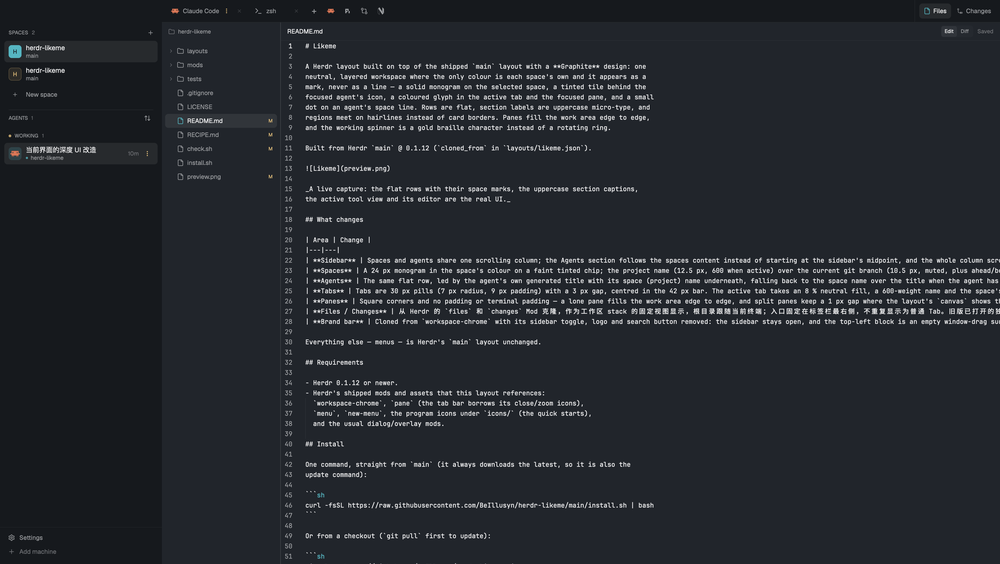

# Likeme

A Herdr layout built on `main` with a **Graphite** design: a neutral, layered workspace
where each space's colour appears only as a mark — a solid monogram on the selected space,
a tinted tile behind the focused agent's icon, a coloured glyph in the active tab and the
focused pane, a dot on an agent's space line. Rows are flat, section labels are uppercase
micro-type, and regions meet on hairlines instead of card borders. Panes fill the work area
edge to edge, and the working spinner is a gold braille text spinner instead of a rotating
ring.



_A live capture: the flat rows and their space marks, the uppercase captions, the active
tool view and its editor are the real UI._

## What you see

The window is Herdr's `main` layout with six mods replaced. No system title bar
(`"titlebar": "none"`); on macOS the traffic lights sit at `[12, 16]`. The root is the
theme's `canvas`; the sidebar and the tab bar are the theme's `chrome`; the pane header
is `surface`; the terminal and the reading half of the two tool views are `background`.
Regions meet on 1 px hairlines (the foreground at 5–7 %) instead of dividers or card
borders, and the visible hierarchy comes from those neutral steps.

The design system lives in `colors.js` — one identical copy in `my-sidebar`, `my-tabs`,
`my-pane`, `my-files` and `my-changes`. `UI` holds the neutral alphas (`hover` 3 %,
`active` 8 %, `line` 7 %) and the resting-mark alphas (`tint` 11 %, `tintEdge` 23 %);
`TYPE` holds the scale (label 9.5, meta 10.5, small 11.5, body 12.5). A space's colour is
taken from the theme's own ANSI palette by name, so a light theme gets its light palette
and the layout follows the terminal theme. The space colour appears only as a mark: a
solid monogram, a tinted icon tile, a coloured glyph, or a dot — never as a card fill and
never as a line.

**Sidebar (268 px, min 222, max 480, not resizable).** A 46 px empty brand block
(`my-brand`, an empty window-drag surface), then one `sidebar-list` block (`my-sidebar`,
`weight: 1`, `min: 90`), then a 69 px footer (`my-brand` with `props.footer`). The block
is one scrolling column: Spaces section → space rows → "New space" row → hairline →
Agents section. The scrollbar shows itself only while the pointer is over the column.

**Section captions.** `SPACES n` and `AGENTS n` are 9.5 px, 600 weight, uppercase, in
`muted` with the count in `dim`, on a 30 px row with 16 px left padding. A 1 px hairline
(7 %) inset 16 px separates the two sections; the Agents caption follows the spaces
content instead of a fixed half of the sidebar.

**Spaces.** Rows are 40 px (38 px for worktrees), flat 6 px-radius rows inset 8 px from
the sidebar edges with a 2 px gap. Resting rows are transparent; the pointer adds a 3 %
neutral fill; the active row takes an 8 % neutral fill and its monogram turns solid. No
row has a border. Each row:

- a 24 px rounded-6 monogram: at rest, the space's colour at 11 % with a 23 % edge and
  the first letter in that colour at 11 px/600; once selected, the chip fills solid with
  `#101114` ink and no edge;
- the 12.5 px name (600 active, 500 resting) over the 10.5 px `muted` branch, with `↑n`
  in `ansi2` / `↓n` in `ansi1`; `detached` when the branch is unknown;
- worktree rows draw a 1 px tree line (foreground at 11 %) under the checkout, the last
  child turning into the row, and a 14 px branch glyph instead of a monogram (the glyph
  takes the space colour when active);
- a 32 px "New space" row follows the list: a 24 px box with an 11 px plus and an
  11.5 px `muted` label, no card.

A machine header (26 px; 9.5 px uppercase `muted`, a 5 px connected dot and a 10 px
chevron) appears once more than one machine is known.

**Agents.** Agent rows are the same 40 px flat rows: a 24 px icon box with the program
icon at 18 px, an 8 px gap, and two lines separated by 1 px. The title is 12.5 px/600
(500 and `muted` when idle); the second line is 10.5 px `muted`, with a 4 px dot in the
space's colour before the space name and `· machine` when the agent is remote. The
focused agent takes the 8 % neutral fill and its 24 px icon box takes an 18 % tint of the
space colour (a tinted glyph turns that colour too). Sub-agent rows are 24 px tall,
indented 40 px, under a 1 px tree line, with 11.5 px names. Group headers
are 24 px rows with a 5 px dot (the status colour in Priority, the space colour in
Grouped) and a 9.5 px label; the count is `dim`. A fixed 30 px slot holds the pin on hover
or the elapsed time (10.5 px `dim`); the status slot is 18 px. The program icon column is
24 px and the icons are not boxed.

**Tabs.** A tab is a 30 px pill (7 px radius, 9 px padding, 7 px gap) in the 42 px bar,
with a 3 px gap between tabs. The active tab is an 8 % neutral fill with a 600 name and
its tinted program icon in the space's colour; inactive tabs are transparent with a
30 %-opacity close button (65 % when active) and lift to a 2.5 % neutral on hover. Name
11.5 px, program icon 15 px, status slot 16 px (spinner 14 px).
The `+` and the four quick starts are 28 px ghost squares; Claude keeps its orange bitmap,
the others are tinted glyphs. A hairline (5 %) sets the fixed `Files`／`Changes` group
apart: 28 px ghost buttons with a 13 px icon and 11.5 px label, the open one on the 8 %
neutral fill with a space-coloured icon. A drag shows a 2 px accent line on the edge the
tab will land on.

**Panes.** Square and edge to edge: no padding, terminal padding or frame border; a lone
pane fills its tab edge to edge, and split panes keep the layout's 1 px gap. The pane
background is the theme's `surface`; the 30 px header is also `surface` and ends on a 1 px
hairline (foreground 6 %). The focused header is `mix(surface, the space's colour, 0.08)`,
its title is 12.5 px/600 `foreground`, and its 13 px program icon takes the space's colour
(the theme's accent when the space has none); an inactive header keeps a `muted`/500 title
and a `dim` icon. Folder 10.5 px `muted` when focused, `dim` otherwise. The split,
zoom and close buttons are 24 px ghosts, always visible; the 58 px status slot shows the
gold braille spinner, a 9.5 px `NEEDS YOU` pill (12 % amber) or a 5 px done dot.

**Files / Changes.** Both are fixed views in the `work-body` stack. Each splits left/right
with the native resizable splitter: the file tree or the changed-file list plus the commit
box on the left in `surface`, the preview or the diff on the right in the terminal's
`background`, divided by a 1 px hairline. The left header is 34 px (9.5 px uppercase
`muted` label, a 16 px count chip); the right header is 32–34 px with a breadcrumb
(directory 9.5 px `dim`, file name 11.5 px/600) and ghost controls. Tree rows are 26 px
(6 px radius, 6 px padding plus 14 px per depth); changed-file rows are 27 px. A selected
row takes the 8 % neutral fill; in the tree the open file's 13 px icon takes the space's
colour. Status letters are 9.5 px/600 (`M` in `ansi3`, `A` in `ansi2`, `D` in `ansi1`,
`U` in `ansi5`); file names are 11.5 px with a 9.5 px `dim` directory prefix. The commit
field and button are 30 px, 6 px radius; the field takes a space-colour focus ring and the
button is `solid` when enabled. The preview header carries an `Edit｜Diff` segmented
control (20 px segments in a 22 px track) and the save status at 10.5 px.

The diff covers the whole file. Its rows are 21 px: a 15 % tint, a 30 px line number and
a 10 px `+`／`−` sign, with no gutter rule; hunk headers are 21 px on a 4 % foreground band.
The side-by-side comparison behind `Edit｜Diff` uses 20 px rows with a 20 % tint on the
changed half, under `BEFORE`／`AFTER` captions. Both lists are virtualized. Empty states are a 32 px circle, a 12.5 px title and a 10.5 px line.
Switching views keeps the tree's open folders and the split widths; closing the layout
ends the timers and folder watches.

## How it behaves

- **Agent status.** Working: a gold braille character cycling through
  `⠋⠙⠹⠸⠼⠴⠦⠧⠇⠏` every 80 ms. Blocked: a `NEEDS YOU` pill (a bare `!` inside a
  group whose header already says it). Idle: a quiet 6 px ring. Done: a 5 px dot. A
  space's and a tab's status is their most urgent agent's.
- **Spaces.** Click selects: the active row takes an 8 % neutral fill and its monogram
  fills solid, while a resting row lifts to 3 % under the pointer. Drag a row to
  reorder inside its machine; the accent line shows where it lands. Right-click opens
  Herdr's `menu` with the `space` context. Worktrees sort under their checkout and hang
  from a 1 px tree line; the last child turns into its row instead of continuing. The +
  button creates a space; the quiet "New space" row does the same.
- **Sidebar.** Spaces and agents share one scroll: the Agents header follows the spaces
  content instead of a fixed half. Each section keeps its own folds and hover states.
- **Agents.** Click focuses that agent's pane. Hover reveals the pin (pins survive on
  the terminal label). The chevron folds sub-agents. The header icon opens the sort
  popup (Priority / Grouped by space). Group headers and machine headers fold; Priority's
  section headers stay visible even when only one section has agents.
- **Tabs.** Click selects; the active tab is an 8 % neutral pill with a 600 name and its
  tinted program icon in the space's colour. Drag reorders (`tab.move`) with an accent line on the edge it
  will land on, double-click renames, right-click opens the tab menu, every close
  button closes its own tab. A tab still named by its number is shown by what it runs,
  so "1" becomes the folder or program name; renaming a tab always wins. The `+` opens
  Herdr's `new-menu` popup, and four one-click starts follow it (Claude Code, Pi,
  Lazygit, Neovim): each runs `tab.new` with its `argv`, so Herdr opens a tab in the
  focused folder, and each uses the program table's own icon (`icons/claude.svg` as a
  full-colour image, the rest as tinted glyphs). Claude starts with
  `--dangerously-skip-permissions`, so it never stops for a permission prompt.
- **Pane header.** Click focuses the pane. Only the focused header is mixed with 8 % of
  the space's colour, brightens its title to `foreground`/600 and takes the space colour
  on its icon; inactive headers stay plain `surface` with a `muted`/500 title. The split-right, split-down, zoom/unzoom and close buttons are always
  visible, and the status slot keeps its width when there is one (working spinner,
  `NEEDS YOU`, done dot); an idle agent shows nothing. Each button acts on its own pane
  (`props().pane`), not the focused one. Working shows the same braille character as the
  tabs and agents.
- **Files / Changes.** 两个固定入口位于标签栏最右侧，不随标签滚动。点击切换整个工作区，
  不新建 Tab；选中的入口使用选中态底色，再次点击或选择普通 Tab 就返回终端。
  Diff 覆盖整个文件（`git diff -U1000000`，未改动的行也作为上下文，最多 20,000 行）；
  右侧标题行显示文件路径，`↑`／`↓` 在连续的新增/删除块之间跳转，`Files` 把同一个文件
  交给 Files 视图（`shared("files.open")` 传仓库根和相对路径；终端停在子目录时 Files
  仍按仓库根预览，不改变自己的树根）。Diff 的新增/删除行用 15% 的 ansi 色铺底，
  行号右侧再放一个同色的 `+`／`−` 标记，不靠颜色也能分辨。
  快捷键、侧栏或新建 Tab 改变当前终端时，也会退出工具视图。
  旧版已存在的单独工具 Tab 从普通列表中隐藏，由固定入口复用，避免丢失编辑和分栏状态。
  Files 预览标题行的 `Edit｜Diff` 分段开关把编辑器切成“变更前／变更后”两栏：左侧旧文件、
  右侧工作区文件，删除/新增各占半边并带底色，未跟踪文件整份算新增；点 `Edit` 回到编辑器。
- Everything else (the palette, dialogs and notifications) is unchanged from `main`.

## Built from

**Layout tree** (`layouts/likeme.json`, `cloned_from {name: "main", version:
"0.1.12"}`):

```
root row (canvas, titlebar none, traffic_lights [12,16], terminal_padding [0,0], no divider)
├─ sidebar column (268px, min 222, max 480, background chrome, resizable false)
│  ├─ brand block (46px, my-brand, window_drag; empty drag surface)
│  ├─ sidebar-list block (weight 1, min 90, mod my-sidebar)
│  │  └─ one scroll: Spaces section (spaces.js) + Agents section (agents.js)
│  └─ sidebar-footer block (69px, my-brand, props {footer: true})
└─ work column (resizable false)
   ├─ tabs block (42px, mod my-tabs, window_drag)
   └─ work-body stack (padding 0, active main)
      ├─ main block {tab: active, pane: {gap 1, radius 0, background surface,
      │             lone true, header {mod my-pane, height 30, reveal always}}}
      ├─ files block (my-files, props {workspace: true})
      └─ changes block (my-changes, props {workspace: true})
```

Files／Changes 直接属于布局，不调用 `tab.new`。固定入口通过
`layout.select {stack: "work-body", child: "files" | "changes" | "main"}` 切换内容，
Herdr 保留隐藏的子视图实例，并保存 stack 的选择。
`props.workspace` 让两种工具跟随当前终端目录；旧版独立工具 Tab 不带此标志，仍保留原目录，
入口会优先复用它们而不强行关闭。

**Mods.**

| Mod | Role |
|---|---|
| `my-sidebar` | One mod, two retained child views (`spaces.js` and `agents.js`) composed in a single hover-scrollbar column (`main.js`); `colors.js` holds `MARK`/`markColor()` (theme ANSI first, the fallback table second), `withAlpha()`, and the `UI`/`TYPE` tokens the whole layout shares; `util.js` holds the background-tick throttle. It keeps the spaces logic (git lookup via `exec`, `hc machine ls`, `watchFolder`, drag-reorder) and the agents logic (live agent data, pins, groups, sub-agent trees) unchanged. Changed: the two sections share one scroll (no 50/50 split), the Agents caption follows the spaces content behind a hairline, spaces and agents are flat 40 px rows (38 for worktrees, 24 for sub-agents) inset 8 px with 2 px gaps, a resting row is transparent, hover is a 3 % neutral lift, selection is an 8 % neutral fill with a solid monogram (or a tinted icon tile on an agent), and the status marks and two-line type scale were tightened. The sort popup mounts a second copy of this mod (`props.sortMenu`) and returns only the agents view. |
| `my-tabs` | The tab bar. Clone of the shipped `tabs`. Changed: 30 px pills (7 px radius, 9 px padding, 7 px gap, 3 px between), 15 px icons, distinct labels for default-numbered tabs, `+` and four quick-start ghosts after ordinary tabs (Claude Code, Pi, Lazygit, Neovim via `tab.new`), close button at 30 % (65 % when active), the active tab on the 8 % neutral fill with a 600 name and a space-coloured glyph, a drag-to-reorder line, zoom glyph, spinner `frames([...], 80)`. Files／Changes 固定在标签栏最右侧、不随标签滚动，是一排 28 px 幽灵按钮（当前入口用 8% 中性底色和空间色图标），使用 `layout.select` 切换工作区 stack，不创建额外 Tab；再次点击返回终端。旧工具 Tab 由固定入口复用，不再重复显示。 |
| `my-pane` | The pane header. Clone of the shipped `pane`. Changed: the header is the theme's `surface` with a 1 px hairline, 12.5 px/600 title and 10.5 px `muted` folder, the focused header mixed with 8 % of the space's colour with a brighter title and a space-coloured icon (no animation), braille working spinner instead of the rotating SVG, 24 px ghost buttons, and it keeps the split/zoom/close buttons. |

Herdr functions used: `spaces`, `agents`, `terminals`, `panes`, `focused`, `layout`,
`theme`, `window`, `settings`, `keys`, `home`, `shared` / `setShared`, `setAgentOrder`,
`run`, `openOverlay` / `closeOverlay`, `props`, `exec`, `readTextFile`,
`writeTextFile`, `hc`, `watchFolder`, `localStorage`.

Commands used: `space.select`, `space.move`, `space.new`, `tab.new`, `tab.select`,
`tab.move`, `tab.close`, `tab.rename`, `pane.focus`, `pane.split`,
`pane.zoom`, `pane.close`, `terminal.pin`, `terminal.peek`, `window.minimize`,
`window.maximize`, `window.close`, `app.palette`.

Programs run: `git` (via `exec`), `hc machine ls` (via `hc`). The quick starts ask
Herdr to run `claude --dangerously-skip-permissions`, `pi`, `lazygit` and `nvim`
(`tab.new`'s `argv`); the mod never spawns them itself.

Art: Herdr's shipped `mods/workspace-chrome/*.svg` (branch, plus, chevron-down/right,
pin, pin-off, server, monitor, check, layers, settings), `icons/claude.svg`, `icons/pi.svg`,
`icons/lazygit.svg` and `icons/nvim.svg` (the quick starts), `mods/pane/close.svg` and
`zoom.svg` (used by `my-tabs`), `mods/files/file.svg`, `mods/changes/changes.svg`;
`my-sidebar` carries its own `sort.svg`; `my-pane` carries its own
`close/split/zoom` SVGs; `my-tabs` carries its own `win-min/max/restore/close.svg`
copies for Windows.

## Watch out

- **Clones never update.** Herdr replaces its shipped
  `spaces`/`agents`/`tabs`/`pane` on every start; these four sources
  are frozen at 0.1.12. After a Herdr upgrade, diff each shipped `main.js` against its
  copy and port whatever changed (`spaces`→`my-sidebar/spaces.js`,
  `agents`→`my-sidebar/agents.js`, `tabs`→`my-tabs`, `pane`→`my-pane`).
- `my-sidebar` is a composition, not a clone: `main.js` mounts two retained child
  views with `cx.new(..., { embedded: true })`. The child reads `embedded` from its
  `init(props)` argument, **not** from the global `props()` (which is the host mod's
  props). Without that flag each child paints `size_full` and the 50/50 split returns.
  The sort popup mounts a second copy of `my-sidebar` with `props.sortMenu` and renders
  only the agents entity.
- A retained child does **not** get the host mod's live-data redraws. `Agents` watches
  what the list shows on a 250 ms timer — status, focus, pin, names, space colours,
  the sort, the current minute (the elapsed time under each row) — and redraws only when
  that signature changes. Without it a status turn or a focus change waited for the
  next hover (which redraws) or 30 s. `Spaces` polls at 250 ms for git. Both timers
  take only one look in four while the window is in the background, and catch up
  within a second of it coming forward. Keep both when porting a shipped clone into
  the composition.
- If you upgrade from a version before the merge, delete the old
  `~/.config/herdr-app/mods/my-spaces` and `my-agents` folders by hand; `install.sh`
  never removes mods it did not install this run.
- The mods read shipped assets by path (`mods/workspace-chrome/...`,
  `mods/pane/close.svg` in `my-tabs`). If Herdr renames them, update the paths.
  `my-pane` uses its own `mods/my-pane/*.svg` copies instead.
- The focused header is `mix(t.surface, fill, 0.08)` with a brighter title and a
  space-coloured icon, drawn by the mod on its own header surface. `colors.js` (the shared
  `MARK`, `markColor`,
  `withAlpha`, `UI` and `TYPE`) is one file copied into `my-sidebar`, `my-tabs`,
  `my-pane`, `my-files` and `my-changes`; `check.sh` fails when they drift. The colour
  comes from `shared("space.colors")[space.id]`; `markColor` prefers the theme's own
  `ansiN` colour and falls back to `MARK`, so a light theme gets its own palette. A
  space with no colour falls back to the theme's `accent` for its icon and `raised` for
  the header mix. It is a solid fill because Herdr's pane frame exposes only a solid
  `border`/`focus` colour and `pane.background` ignores `gradient` and `image`; a
  layout-node background image with `terminal_opacity` below 1 shows ghosting. Layout
  `focus`/`background` changes apply when the layout loads, not on a live save: run
  `herdr-app do layout.switch '{"name":"likeme"}'` after editing. Mod edits hot reload.
- The header is the only surface that can take the space tint: a mod draws it, while
  the pane frame around the terminal can only be a solid colour. Do not try to move the
  tint onto the pane `background` — it would colour every pane, focused or not.
- **Performance rules for these mods.** Every `spaces()`, `panes()`, `agents()` or
  `terminals()` call copies the whole host list into JS, so read each one once per
  render/tick and pass the snapshot down (the agents view used to call `panes()` once
  per row). `setShared` re-renders every mod, so never call it from `render`:
  `Spaces` assigns colours from `init` and its tick. `run()`/`migratePins()` also stay
  out of render. Place keys are `machine + "\u0000" + folder`, not JSON, so the
  250 ms tick does no parsing; `git status` adds `-uno --no-renames` because only its
  branch lines are read, and the two `rev-parse` answers come from one process.
  A git look that finds nothing new no longer redraws the list.
- **Do not build a row per file.** The Files tree and the changed-file list use
  `v_virtual_list`; a renderer may not register handlers or retain state, so the row
  helpers are pure and the click is the list's `on_item_click` (keyed by path). A
  non-virtualized tree built up to 5,000 elements on every render.
- **The diff is the whole file.** `git diff -U1000000` makes every unchanged line
  context, cut at 20,000 rows and 4,000 characters per line. The header's `↑`／`↓`
  walk the contiguous `+`／`-` blocks (`changeStarts`); `v_virtual_list` is driven by a
  `VirtualListScrollHandle` created in `init`. The Files button writes
  `shared("files.open") = { root, path, at }` and selects the `files` stack view;
  `my-files` accepts the request only in the workspace copy and ignores anything older
  than 30 s, because `shared.json` survives a restart. Files' own `Diff` toggle runs
  the same full-context diff against HEAD and pairs the unified rows into a left/right
  table (`diffPairs`: a run of deletions paired with the following run of additions,
  context rows on both sides); untracked files are read as all additions. The
  `Edit｜Diff` segmented control in the preview header switches modes.
- **Saving is optimistic and whole-file.** `writeTextFile(path, text, expected)`
  replaces the file only while it still holds `expected` (the text the copy read or last
  wrote), so a file changed elsewhere says "Save failed" instead of being overwritten;
  reopening the file loads the new content. A preview over 400,000 characters is cut for
  display and stays read-only, so the cut text never goes back to disk. There is no
  range API: every save writes the whole file. The editor writes on a 700 ms debounce
  and again on blur, submit, a file switch and `close`; `set_value` keeps the change
  listener out of the keystroke path.
- Heights are fixed: 40 px agent/space rows, 38 px worktree rows, 24 px sub-agent rows,
  30 px tabs in a 42 px bar, 26 px file rows, 27 px changed-file rows, 21 px diff rows.
  A larger font will clip rather than grow.
- The neutral steps are the foreground colour at low alpha (`UI.hover` 3 %, `active`
  8 %, `line` 7 %), so they read identically on `chrome`, `surface` and `background` and
  follow a light theme. A space colour only ever appears as a solid monogram, a tinted
  icon tile, a coloured glyph, a resting tint or a dot — never as a full row fill and
  never as a rail or underline. The tab status slot is always 16 px, so a state turn
  never changes a tab's width.
- The spinner is `frames([...], 80)`, not `spin()`: a native SVG rotation runs at
  about 30 fps and reads as steppy at 12–16 px. `frames` swaps text natively on one
  shared clock.
- Mod names (`my-sidebar`, `my-tabs`, `my-pane`, `my-files`, `my-changes`, `my-brand`)
  are deliberately generic. Rename them on install if they clash, and update the
  `"mod"` fields in `likeme.json`.
- Files／Changes 是 `work-body` stack 的子节点，选择由 Herdr 保存，不需要额外的
  `localStorage`。隐藏视图仍保留实例。`my-tabs` 不创建工具 Tab；只为兼容升级，
  按唯一 Mod pane 识别旧工具 Tab，将其从普通列表隐藏，并复用原实例。
- Space colours are shared through `"space.colors"`; every layout sees the stored
  names. `markColor` resolves a name against the current theme's ANSI palette first,
  so this layout follows the terminal theme while the shipped spaces keep their own
  table.
- Only this layout is customized. `terminals` and `win98` keep Herdr's look.
- On macOS the empty brand block leaves room for the traffic lights; the tab bar does
  not need to, because the sidebar is always expanded.
- The pane and header surface is the theme's `surface`, and the focused header's tint
  mixes against it, so the layout follows both light and dark themes; `raised` is the
  fallback for a focused space with no colour.
- `line_height` takes a bare number as a multiplier (`1.45`), not pixels. The two-line
  rows use `"15px"` / `"13px"`; `line_height(16)` would make each line 16× tall.
- A hand-named tab always keeps its name (`TabInfo.named`); only unnamed tabs are
  labelled by the folder or program. The `+` lives inside the scrolling strip, so it
  scrolls with the tabs.

## Done when

- `./check.sh` passes: all six mods load and the five `colors.js` copies are identical.
- `herdr-app do layout.switch '{"name":"likeme"}'` shows the layout and `herdr-app
  status` reports no errors.
- Each space row is a 40 px flat row with a 24 px tinted monogram, a 12.5 px name and a
  10.5 px muted branch; rows are inset 8 px with 2 px gaps.
- The active space takes an 8 % neutral fill and its monogram fills solid, clearly apart
  from the 3 % hover lift; a quiet 32 px "New space" row ends the list.
- Each agent row is the same 40 px flat row with two lines and a 4 px space dot; the
  focused agent takes the neutral fill and a tinted icon tile, sub-agent rows are 24 px,
  and the selection changes within 250 ms of the focus moving. Priority keeps its section
  headers visible even when only one section has agents; a lone space group in the
  grouped view has no header.
- 默认编号的 Tab 显示目录或程序名；普通 Tab 后依次是 `+` 和四个快捷启动，
  Files、Changes 两个入口固定在标签栏最右侧。
- Every tab draws an X close button (30 % dim, 65 % active); the active tab is an 8 %
  neutral pill with a 600 name and a space-coloured glyph; the + and quick starts are
  28 px ghost squares.
- A working agent shows the braille spinner in its agent row, its tab, and the pane
  header; idle keeps a quiet 6 px ring, blocked shows the `NEEDS YOU` pill, done a 5 px
  dot.
- The pane header is `surface` with a 1 px hairline, a 12.5 px/600 title and a 10.5 px
  muted folder; only the focused header is mixed with 8 % of the space colour, brightens
  its title and takes the colour on its icon; in a light theme the header is light too;
  its 24 px buttons still split, zoom and close the pane they belong to.
- Files／Changes 在标签栏最右侧各显示一个固定入口，不随标签滚动；点击只切换工作区，
  不增加 Tab。再次点击、选择普通 Tab，或通过快捷键和侧栏切换终端，都返回终端视图。
  隐藏视图保留文件树和分栏宽度；旧工具 Tab 仍能通过固定入口访问，且不会被强行关闭。
  两种工具都左右分栏：左侧是文件树或修改列表（以及提交框，行高 26/27 px），右侧是
  预览或 diff，选中的条目使用 8% 中性底色（Files 里打开的文件图标取空间色）。Diff
  从文件第一行显示到最后一行（未改动的行也是上下文），行高 21 px，新增/删除使用 15%
  底色和同色的 `+`／`−` 符号；标题行的 `↑`／`↓` 一次跳过一个变动块，`Files` 把当前
  文件交给 Files 视图并定位到它。
- A file opened in Files can be typed into and saves itself after a pause (or on blur,
  a file switch and closing the view); the header says Saved / Saving… / Save failed,
  and the file on disk changes. A file edited elsewhere rejects the write instead of
  being overwritten, and a truncated (>400,000 characters) preview stays read-only.
- Files 预览的 `Edit｜Diff` 分段开关把编辑器切成左右两栏：左侧旧版本、右侧工作区版本，
  删除/新增行带 2 px 色条和红/绿底色；未跟踪文件整份显示为新增，没有变化的文件给出提示。
- Spaces and agents live in one scroll: the Agents header follows the spaces content
  with no 50/50 boundary, and scrolling moves both sections together.
- A worktree space appears under its checkout with a 1 px tree line; the last child
  turns into its row instead of continuing down.
- Deleting `layouts/likeme.json` and the five `mods/my-*` folders returns the app to
  the shipped layouts.
